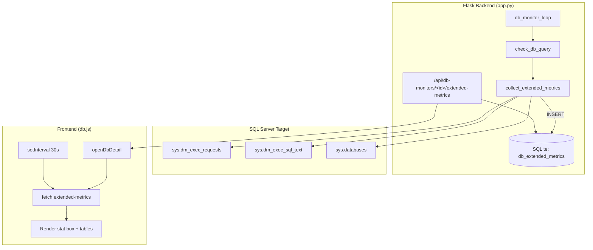

# Design Document: DB Extended Metrics

## Overview

This feature extends the existing database monitoring subsystem to collect and display real-time performance metrics from Microsoft SQL Server instances. The system currently performs basic connectivity checks (`SELECT 1`) and counts active user sessions. This enhancement adds five data streams:

1. **Active Request Count** — number of currently executing queries via `sys.dm_exec_requests`
2. **Running Queries Snapshot** — SQL text, status, wait type, elapsed time, and database for active requests
3. **Database List** — inventory of all databases on the server via `sys.databases`
4. **Blocking Queries** — identification of head blockers and their blocking chains via `sys.dm_exec_requests`, `sys.dm_os_waiting_tasks`, and `sys.dm_exec_sessions`
5. **Long-Running Queries** — a dedicated filtered view of queries exceeding a configurable threshold (default 5 seconds)

These metrics are collected during the existing `db_monitor_loop` cycle, persisted in the `db_extended_metrics` SQLite table, exposed via REST endpoints, and rendered in the frontend detail panel.

### Design Decisions

| Decision | Choice | Rationale |
|----------|--------|-----------|
| Storage model | Separate `db_extended_metrics` table | Avoids schema changes to existing `db_heartbeats`; running_queries is large JSON unsuitable for the compact heartbeat row |
| Collection timing | Same connection as heartbeat check | Avoids double connections to the SQL Server; reuses the already-open pyodbc connection |
| Retention | 100 records per db_id | Extended metrics are verbose (JSON queries); 100 × ~4KB ≈ 400KB per monitor is manageable in SQLite |
| Frontend refresh | 30-second `setInterval` on detail panel | Matches the monitoring intervals; avoids WebSocket complexity |
| Query text truncation | 500 chars stored, 200 displayed | Balance between usefulness and storage; expand-on-click for full text |

## Architecture



### Data Flow

1. `db_monitor_loop` iterates enabled monitors every 5 seconds (checking interval thresholds)
2. For MSSQL monitors with credentials, `check_db_query` opens a pyodbc connection, runs `SELECT 1` and session count (existing behavior)
3. **New**: After the heartbeat INSERT, `collect_extended_metrics` reuses the same connection to:
   - Query `sys.dm_exec_requests` + `sys.dm_exec_sql_text` for active request count and running queries
   - Query `sys.databases` for the database list
4. Results are INSERTed into `db_extended_metrics`, with a retention purge of records beyond 100 per db_id
5. The frontend fetches `/api/db-monitors/<id>/extended-metrics` on detail panel open and every 30 seconds

## Components and Interfaces

### Backend Components

#### `collect_extended_metrics(conn, db_id: int) -> None`

New function called from within `check_db_query` (or immediately after) while the pyodbc connection is still open.

**Parameters:**
- `conn` — open pyodbc connection to the MSSQL target
- `db_id` — integer ID of the db_monitor

**Behavior:**
1. Queries active request count (excluding system sessions and own session)
2. Queries running queries with SQL text (top 50, ordered by elapsed_time descending)
3. Queries database list from `sys.databases`
4. INSERTs results into `db_extended_metrics`
5. Purges records beyond the most recent 100 for this db_id
6. Each query is wrapped in try/except — failure of one does not prevent the others

**SQL Queries Used:**

```sql
-- Active request count
SELECT COUNT(*) FROM sys.dm_exec_requests
WHERE session_id > 50 AND session_id != @@SPID

-- Running queries (top 50 by elapsed time)
SELECT TOP 50
    r.session_id,
    LEFT(CAST(t.text AS NVARCHAR(MAX)), 500) AS sql_text,
    r.status,
    r.wait_type,
    r.total_elapsed_time AS elapsed_time_ms,
    DB_NAME(r.database_id) AS database_name
FROM sys.dm_exec_requests r
CROSS APPLY sys.dm_exec_sql_text(r.sql_handle) t
WHERE r.session_id > 50 AND r.session_id != @@SPID
ORDER BY r.total_elapsed_time DESC

-- Database list
SELECT name, state_desc, compatibility_level
FROM sys.databases
ORDER BY name
```

#### `api_get_extended_metrics(did: int) -> Response`

New Flask route handler for `GET /api/db-monitors/<id>/extended-metrics`.

**Response Codes:**
- 200 — Success with metrics data, or success with null values + message
- 401 — Unauthenticated (handled by `@auth_required`)
- 404 — Monitor not found

**Response Schema (200 with data):**
```json
{
  "active_requests": 12,
  "running_queries": [
    {
      "sql_text": "SELECT * FROM ...",
      "status": "running",
      "wait_type": "CXPACKET",
      "elapsed_time_ms": 4523,
      "database_name": "MyDB"
    }
  ],
  "databases_list": [
    {
      "name": "master",
      "state_desc": "ONLINE",
      "compatibility_level": 150
    }
  ],
  "collected_at": "2025-01-15 14:30:00"
}
```

### Frontend Components

#### Extended Metrics Rendering (in `openDbDetail`)

After the existing stat boxes and charts, the detail view adds:
1. **Active Requests stat box** — same pattern as existing boxes, `val-blue` color
2. **Running Queries table** — sortable by elapsed time, monospace SQL text, expand/collapse
3. **Database List table** — color-coded state badges

#### Auto-refresh Timer

```javascript
let extMetricsInterval = null;

// Started when detail panel opens (MSSQL + credentials only)
extMetricsInterval = setInterval(() => refreshExtendedMetrics(dbId), 30000);

// Cleared when detail panel closes
clearInterval(extMetricsInterval);
```

### Interface Contract

| Endpoint | Method | Auth | Description |
|----------|--------|------|-------------|
| `/api/db-monitors/<id>/extended-metrics` | GET | `@auth_required` | Returns latest extended metrics for a monitor |

## Data Models

### New SQLite Table: `db_extended_metrics`

```sql
CREATE TABLE IF NOT EXISTS db_extended_metrics (
    id              INTEGER PRIMARY KEY AUTOINCREMENT,
    db_id           INTEGER NOT NULL,
    active_requests INTEGER,
    running_queries TEXT,       -- JSON array of query objects
    databases_list  TEXT,       -- JSON array of database objects
    collected_at    TEXT NOT NULL DEFAULT (datetime('now')),
    FOREIGN KEY (db_id) REFERENCES db_monitors(id)
);

CREATE INDEX IF NOT EXISTS idx_dbext_id_time
    ON db_extended_metrics (db_id, collected_at);
```

### JSON Schemas

**running_queries element:**
```json
{
  "sql_text": "string (max 500 chars)",
  "status": "string",
  "wait_type": "string | null",
  "elapsed_time_ms": "integer",
  "database_name": "string"
}
```

**databases_list element:**
```json
{
  "name": "string",
  "state_desc": "string",
  "compatibility_level": "integer"
}
```

### Retention Policy

After each INSERT into `db_extended_metrics`, delete old records:

```sql
DELETE FROM db_extended_metrics
WHERE db_id = ? AND id NOT IN (
    SELECT id FROM db_extended_metrics
    WHERE db_id = ?
    ORDER BY collected_at DESC
    LIMIT 100
)
```

### Cascade Delete

When a db_monitor is deleted, add to the existing delete handler:

```python
conn.execute("DELETE FROM db_extended_metrics WHERE db_id=?", (did,))
```

## Correctness Properties

*A property is a characteristic or behavior that should hold true across all valid executions of a system — essentially, a formal statement about what the system should do. Properties serve as the bridge between human-readable specifications and machine-verifiable correctness guarantees.*

### Property 1: Extended Metrics Serialization Round-Trip

*For any* valid extended metrics record containing a non-negative integer `active_requests`, a JSON array of running query objects (each with sql_text, status, wait_type, elapsed_time_ms, database_name), and a JSON array of database objects (each with exactly three fields: name, state_desc, compatibility_level), storing the record in `db_extended_metrics` and retrieving it via the API SHALL produce values equivalent to the original input.

**Validates: Requirements 1.2, 2.2, 3.2, 3.5, 4.1**

### Property 2: Error Resilience — Graceful Degradation

*For any* exception raised during extended metrics collection (active requests query, running queries query, or database list query), the system SHALL store NULL for the failed metric's field, SHALL NOT raise an exception that terminates the heartbeat loop, and the overall heartbeat status SHALL remain unaffected by the metric collection failure.

**Validates: Requirements 1.3, 2.6, 3.4**

### Property 3: Query Text Truncation

*For any* SQL text string, after applying the truncation logic, the resulting string SHALL have a length less than or equal to 500 characters, AND if the original string's length was less than or equal to 500 characters then the result SHALL be identical to the original.

**Validates: Requirements 2.3**

### Property 4: Running Queries Bounded and Sorted

*For any* set of active requests returned from the DMV query (of any size from 0 to N), the stored running queries snapshot SHALL contain at most 50 entries, AND the entries SHALL be ordered by elapsed_time_ms in descending order.

**Validates: Requirements 2.4**

### Property 5: Retention Invariant

*For any* db_id, after any sequence of extended metrics insertions (regardless of count), the number of `db_extended_metrics` records for that db_id SHALL never exceed 100, AND the retained records SHALL be the 100 most recent by collected_at.

**Validates: Requirements 8.4, 8.5**

### Property 6: Cascade Delete — No Orphan Records

*For any* db_id that has associated extended metrics records, after deleting the db_monitor with that id, the count of `db_extended_metrics` records where db_id equals that id SHALL be zero.

**Validates: Requirements 8.6**

### Property 7: Database State Color Mapping

*For any* database state string from the set {ONLINE, OFFLINE, RESTORING, RECOVERING, RECOVERY_PENDING, SUSPECT, EMERGENCY, COPYING, OFFLINE_SECONDARY}, the color mapping function SHALL return green for ONLINE, red for OFFLINE, yellow for RESTORING or RECOVERING, and a default neutral color for all other states.

**Validates: Requirements 7.3**

## Error Handling

### Backend Error Strategy

All extended metrics collection follows a **fail-safe** pattern: errors in metric collection never compromise the heartbeat check.

| Error Scenario | Handling | Stored Value |
|---------------|----------|--------------|
| `sys.dm_exec_requests` permission denied | Log warning, continue | `active_requests = NULL` |
| `sys.dm_exec_sql_text` cross apply fails | Log warning, continue | `running_queries = NULL` |
| `sys.databases` query fails | Log warning, continue | `databases_list = NULL` |
| Connection timeout during extended queries | Log error, continue | All fields NULL |
| JSON serialization error | Log error, store NULL | Affected field NULL |
| SQLite INSERT fails | Log error, do not retry | No record stored for this cycle |

### Error Handling Implementation Pattern

```python
def collect_extended_metrics(conn, db_id):
    active_requests = None
    running_queries = None
    databases_list = None

    # Each query wrapped independently
    try:
        cur = conn.cursor()
        cur.execute("SELECT COUNT(*) FROM sys.dm_exec_requests WHERE session_id > 50 AND session_id != @@SPID")
        active_requests = cur.fetchone()[0]
    except Exception as e:
        print(f"[DB EXT] active_requests failed for db_id={db_id}: {e}")

    try:
        # ... running queries logic ...
        pass
    except Exception as e:
        print(f"[DB EXT] running_queries failed for db_id={db_id}: {e}")

    try:
        # ... databases list logic ...
        pass
    except Exception as e:
        print(f"[DB EXT] databases_list failed for db_id={db_id}: {e}")

    # Store whatever we got (NULLs are fine)
    try:
        with DB_LOCK, get_db() as local_conn:
            local_conn.execute(
                "INSERT INTO db_extended_metrics (db_id, active_requests, running_queries, databases_list) VALUES (?,?,?,?)",
                (db_id, active_requests,
                 json.dumps(running_queries) if running_queries is not None else None,
                 json.dumps(databases_list) if databases_list is not None else None)
            )
            # Retention purge
            local_conn.execute("""
                DELETE FROM db_extended_metrics
                WHERE db_id = ? AND id NOT IN (
                    SELECT id FROM db_extended_metrics WHERE db_id = ? ORDER BY collected_at DESC LIMIT 100
                )
            """, (db_id, db_id))
    except Exception as e:
        print(f"[DB EXT] Storage failed for db_id={db_id}: {e}")
```

### Frontend Error Strategy

| Error Scenario | Handling | UI Behavior |
|---------------|----------|-------------|
| API returns 401 | Axios interceptor redirects to login | Standard auth flow |
| API returns 404 | Hide extended metrics section | No visible error |
| API returns null values | Display dash (–) in stat boxes | Graceful degradation |
| Fetch timeout (10s) | Show inline error message | Other sections preserved |
| Network failure | Show "Could not load" message | Retry on next 30s cycle |

## Testing Strategy

### Unit Tests

Unit tests cover specific examples, edge cases, and integration points:

| Test | What it verifies |
|------|-----------------|
| `test_init_db_creates_extended_metrics_table` | Table and index exist after startup |
| `test_api_404_for_nonexistent_monitor` | Returns 404 for bad ID |
| `test_api_200_no_credentials` | Returns message + nulls when username missing |
| `test_api_200_no_data_yet` | Returns message + nulls when no records exist |
| `test_api_requires_auth` | Returns 401 without session |
| `test_cascade_delete_removes_extended_metrics` | DELETE monitor removes all ext metrics |
| `test_empty_queries_returns_empty_array` | Empty running_queries stored as `[]` |
| `test_detail_view_hides_for_postgres` | No extended sections for non-MSSQL |
| `test_refresh_interval_30s` | setInterval called with 30000 |

### Property-Based Tests

Property-based tests validate universal properties across randomly generated inputs. Each test runs a **minimum of 100 iterations** using the `hypothesis` library (Python).

| Property Test | Design Property | Tag |
|--------------|-----------------|-----|
| `test_prop_serialization_roundtrip` | Property 1 | Feature: db-extended-metrics, Property 1: Extended Metrics Serialization Round-Trip |
| `test_prop_error_resilience` | Property 2 | Feature: db-extended-metrics, Property 2: Error Resilience — Graceful Degradation |
| `test_prop_query_truncation` | Property 3 | Feature: db-extended-metrics, Property 3: Query Text Truncation |
| `test_prop_queries_bounded_sorted` | Property 4 | Feature: db-extended-metrics, Property 4: Running Queries Bounded and Sorted |
| `test_prop_retention_invariant` | Property 5 | Feature: db-extended-metrics, Property 5: Retention Invariant |
| `test_prop_cascade_delete` | Property 6 | Feature: db-extended-metrics, Property 6: Cascade Delete — No Orphan Records |
| `test_prop_state_color_mapping` | Property 7 | Feature: db-extended-metrics, Property 7: Database State Color Mapping |

### Test Configuration

```python
from hypothesis import given, strategies as st, settings

@settings(max_examples=100)
@given(
    active_requests=st.integers(min_value=0, max_value=10000),
    queries=st.lists(st.fixed_dictionaries({
        'sql_text': st.text(min_size=0, max_size=1000),
        'status': st.sampled_from(['running', 'suspended', 'sleeping', 'background']),
        'wait_type': st.one_of(st.none(), st.text(min_size=1, max_size=50)),
        'elapsed_time_ms': st.integers(min_value=0, max_value=86400000),
        'database_name': st.text(min_size=1, max_size=128)
    }), min_size=0, max_size=200),
    databases=st.lists(st.fixed_dictionaries({
        'name': st.text(min_size=1, max_size=128),
        'state_desc': st.sampled_from(['ONLINE', 'OFFLINE', 'RESTORING', 'RECOVERING', 'SUSPECT']),
        'compatibility_level': st.integers(min_value=80, max_value=160)
    }), min_size=0, max_size=50)
)
def test_prop_serialization_roundtrip(active_requests, queries, databases):
    """Feature: db-extended-metrics, Property 1: Extended Metrics Serialization Round-Trip"""
    # Store and retrieve, verify equivalence
    ...
```

### Integration Tests

| Test | Scope |
|------|-------|
| `test_full_collection_cycle_with_mocked_pyodbc` | Mock pyodbc connection, verify full collection writes correct data |
| `test_monitor_loop_skips_non_mssql` | Verify postgres monitors don't trigger extended collection |
| `test_api_endpoint_returns_latest_record` | Insert multiple records, verify API returns most recent |

