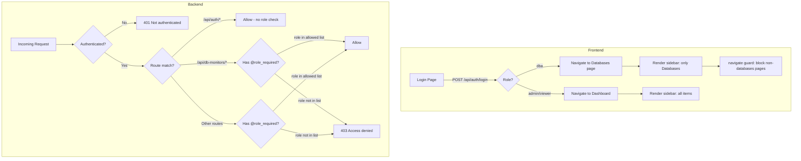

# Design Document: DBA Role Access Control

## Overview

This design introduces a `dba` role to the CROIT Monitor APP's role-based access control system. The `dba` role restricts users to only the Databases section — both at the API layer (backend route guards) and in the UI (frontend navigation filtering). The implementation follows a default-deny approach: DBA users are explicitly allowed access to `/api/db-monitors/*` and `/api/auth/me`, while all other routes return HTTP 403.

### Design Goals

- **Least privilege**: DBA users can only interact with database monitors
- **Defense in depth**: Enforce restrictions at both backend (decorator) and frontend (navigation) layers
- **Backwards compatibility**: Existing `admin` and `viewer` roles remain unchanged
- **Developer ergonomics**: A reusable `@role_required` decorator simplifies future role-based restrictions

### Key Design Decisions

| Decision | Rationale |
|----------|-----------|
| Backend-first enforcement | API layer is the security boundary; frontend filtering is UX convenience only |
| Decorator-based guards | Matches existing `@auth_required` / `@admin_required` pattern in app.py |
| Default-deny for DBA | New routes are automatically restricted without developer action |
| DOM removal (not CSS hide) | Prevents bypassing navigation restrictions via browser dev tools |
| Allowlist approach | Safer than denylist — new routes are automatically restricted |

## Architecture



### Layer Responsibilities

| Layer | Responsibility |
|-------|---------------|
| `@role_required` decorator | Enforce per-route role restrictions at the API level |
| `/api/db-monitors/*` routes | Decorated with `@role_required(['admin', 'dba'])` to allow DBA access |
| Other `/api/*` routes | Decorated with `@role_required(['admin'])` or `@role_required(['admin', 'viewer'])` as appropriate |
| Frontend `checkAuth()` | Store role in `currentUserInfo`, apply navigation filtering |
| Frontend `navigate()` | Guard against programmatic navigation to restricted pages |

## Components and Interfaces

### Backend Components

#### 1. `role_required` Decorator

A reusable decorator factory that checks if the current user's role is in an allowed list.

```python
def role_required(allowed_roles):
    """
    Decorator factory that restricts route access to users with specific roles.
    
    Args:
        allowed_roles: list of role strings (1-10 items). 
                       Valid roles: 'admin', 'viewer', 'dba'
    
    Returns:
        - 401 if user is not authenticated
        - 403 if user's role is not in allowed_roles
        - Proceeds to route handler if role is allowed
    """
    def decorator(f):
        from functools import wraps
        @wraps(f)
        def decorated(*args, **kwargs):
            if not current_user.is_authenticated:
                return jsonify({"error": "Not authenticated"}), 401
            if current_user.role not in allowed_roles:
                return jsonify({"error": "Access denied"}), 403
            return f(*args, **kwargs)
        return decorated
    return decorator
```

**Usage:**
```python
@app.route("/api/db-monitors", methods=["GET"])
@role_required(['admin', 'dba'])
def api_get_db_monitors():
    ...

@app.route("/api/monitors", methods=["GET"])
@role_required(['admin', 'viewer'])
def api_get_monitors():
    ...
```

#### 2. Role Validation in User Management

The `/api/users` POST and PUT endpoints add validation:

```python
VALID_ROLES = {'admin', 'viewer', 'dba'}

# In api_create_user and api_update_user:
role = d.get("role", "viewer")
if role not in VALID_ROLES:
    return jsonify({"error": f"Invalid role: {role}. Must be one of: admin, viewer, dba"}), 400
```

#### 3. Route Protection Matrix

| Route Group | Allowed Roles | Decorator |
|-------------|---------------|-----------|
| `/api/auth/*` | All (no decorator) | None — public/session endpoints |
| `/api/db-monitors/*` | admin, dba | `@role_required(['admin', 'dba'])` |
| `/api/monitors/*` | admin, viewer | `@role_required(['admin', 'viewer'])` |
| `/api/servers/*` | admin, viewer | `@role_required(['admin', 'viewer'])` |
| `/api/software/*` | admin, viewer | `@role_required(['admin', 'viewer'])` |
| `/api/software-catalogue/*` | admin, viewer | `@role_required(['admin', 'viewer'])` |
| `/api/topology/*` | admin, viewer | `@role_required(['admin', 'viewer'])` |
| `/api/status/*` | admin, viewer | `@role_required(['admin', 'viewer'])` |
| `/api/ssl/*` | admin, viewer | `@role_required(['admin', 'viewer'])` |
| `/api/maintenance/*` | admin, viewer | `@role_required(['admin', 'viewer'])` |
| `/api/settings/*` | admin | `@role_required(['admin'])` |
| `/api/users/*` | admin | `@role_required(['admin'])` (replaces `@admin_required`) |
| `/api/version-tracker/*` | admin, viewer | `@role_required(['admin', 'viewer'])` |
| `/api/version-findings/*` | admin, viewer | `@role_required(['admin', 'viewer'])` |
| `/api/agent/*` | admin, viewer | `@role_required(['admin', 'viewer'])` |
| `/api/reports/*` | admin | `@role_required(['admin'])` |

### Frontend Components

#### 1. Role-Based Navigation Filter

Added to `checkAuth()` in `app.js`:

```javascript
// After fetching /api/auth/me:
currentUserInfo = await res.json();
applyRoleRestrictions(currentUserInfo.role);
```

```javascript
const ROLE_ALLOWED_PAGES = {
  dba: ['databases'],
  viewer: ['dashboard', 'status-pages', 'ssl', 'topology', 'databases', 'servers', 'software', 'catalogue', 'version-checks'],
  admin: null  // null = all pages allowed
};

function applyRoleRestrictions(role) {
  const allowed = ROLE_ALLOWED_PAGES[role];
  if (allowed === null) return; // admin sees everything

  // Remove disallowed nav items from DOM entirely
  document.querySelectorAll('.sidebar-item[id^=nav-]').forEach(item => {
    const page = item.id.replace('nav-', '');
    if (!allowed.includes(page)) {
      item.remove();
    }
  });
}
```

#### 2. Navigate Guard

Wraps the existing `navigate()` function to enforce client-side restrictions:

```javascript
const _originalNavigate = navigate;
function navigate(page) {
  if (currentUserInfo && currentUserInfo.role === 'dba' && page !== 'databases') {
    _originalNavigate('databases');
    return;
  }
  _originalNavigate(page);
}
```

#### 3. Post-Login Redirect

In the login handler (login.html or login page JS):

```javascript
const res = await fetch('/api/auth/login', { ... });
const data = await res.json();
if (data.ok) {
  if (data.role === 'dba') {
    window.location.href = '/#databases';
  } else {
    window.location.href = '/';
  }
}
```

#### 4. Init Page Selection

In the `init()` function, after `checkAuth()` succeeds:

```javascript
const ok = await checkAuth();
if (!ok) return;

if (currentUserInfo.role === 'dba') {
  navigate('databases');
} else {
  await refreshDashboard();
}
```

#### 5. Role Dropdown Update

The user management modal's role `<select>` element includes the new option:

```html
<select id="u-role">
  <option value="viewer">viewer</option>
  <option value="admin">admin</option>
  <option value="dba">dba</option>
</select>
```

## Data Models

### Users Table (Existing — No Schema Change)

The `users` table already has a `role TEXT NOT NULL DEFAULT 'viewer'` column. The `dba` value is a new logical value; no DDL migration is required.

```sql
CREATE TABLE IF NOT EXISTS users (
    id         INTEGER PRIMARY KEY AUTOINCREMENT,
    username   TEXT NOT NULL UNIQUE,
    password   TEXT NOT NULL,
    role       TEXT NOT NULL DEFAULT 'viewer',  -- 'admin' | 'viewer' | 'dba'
    created_at TEXT NOT NULL DEFAULT (datetime('now'))
);
```

### Role Enum (Application-Level Constant)

```python
VALID_ROLES = frozenset({'admin', 'viewer', 'dba'})
```

### Auth Response Payloads

**Login Response** (`POST /api/auth/login`):
```json
{"ok": true, "username": "dbadmin", "role": "dba"}
```

**Me Response** (`GET /api/auth/me`):
```json
{"authenticated": true, "username": "dbadmin", "role": "dba"}
```

**403 Response** (Access Denied):
```json
{"error": "Access denied"}
```

**401 Response** (Not Authenticated):
```json
{"error": "Not authenticated"}
```

## Correctness Properties

*A property is a characteristic or behavior that should hold true across all valid executions of a system — essentially, a formal statement about what the system should do. Properties serve as the bridge between human-readable specifications and machine-verifiable correctness guarantees.*

### Property 1: Role Validation Rejects Invalid Values

*For any* string value that is not exactly one of `"admin"`, `"viewer"`, or `"dba"`, the user creation/update API SHALL reject the request with an error response, and the user's role SHALL remain unchanged.

**Validates: Requirements 1.1, 1.4**

### Property 2: DBA Users Can Access All DB-Monitor Endpoints

*For any* endpoint path matching `/api/db-monitors/*` and *for any* valid HTTP method (GET, POST, PUT, DELETE), when a DBA user sends a request, the system SHALL allow the request through to the route handler (i.e., NOT return 403).

**Validates: Requirements 2.1**

### Property 3: DBA Users Are Denied Access to Non-Allowed Endpoints

*For any* API endpoint path that does NOT match `/api/db-monitors/*` and does NOT match `/api/auth/*`, when a DBA user sends a request, the system SHALL return HTTP 403 with a JSON body containing an `"error"` key.

**Validates: Requirements 2.2, 2.4**

### Property 4: Navigate Guard Redirects DBA to Databases

*For any* page name value that is not `"databases"`, when a DBA user's session is active and `navigate(page)` is invoked, the visible page SHALL be the Databases page (not the requested page).

**Validates: Requirements 4.3**

### Property 5: Role Guard Access Decision

*For any* pair of (user_role, allowed_roles_list), the `role_required` decorator SHALL allow the request if and only if `user_role` is contained in `allowed_roles_list`. If `user_role` is not in the list, it SHALL return HTTP 403.

**Validates: Requirements 6.2, 6.3**

## Error Handling

### Backend Error Responses

| Condition | HTTP Status | Response Body |
|-----------|-------------|---------------|
| Unauthenticated request to guarded route | 401 | `{"error": "Not authenticated"}` |
| DBA user accessing restricted route | 403 | `{"error": "Access denied"}` |
| Invalid role value in user create/update | 400 | `{"error": "Invalid role: <value>. Must be one of: admin, viewer, dba"}` |
| DBA user accessing `/api/users/*` | 403 | `{"error": "Access denied"}` |

### Frontend Error Handling

| Condition | Behavior |
|-----------|----------|
| `/api/auth/me` returns 401 | Redirect to `/login` |
| `/api/auth/me` returns role not recognized | Treat as unauthenticated, redirect to `/login` |
| API call returns 403 | Display toast error "Access denied" |
| `navigate()` called with restricted page for dba | Silently redirect to `databases` page |
| Network error on auth check | Redirect to `/login` |

### Edge Cases

- **Empty allowed_roles list**: `@role_required([])` denies all authenticated users with 403
- **LDAP auto-provisioned user**: Gets `viewer` role by default (not `dba`)
- **Session corruption**: If `currentUserInfo` is null or role is missing, frontend treats user as unauthenticated
- **Browser URL manipulation**: Even if user navigates via URL hash, the `navigate()` guard catches it

## Testing Strategy

### Property-Based Tests (Hypothesis)

The project uses Python with pytest. Property-based testing will use **Hypothesis** (the standard PBT library for Python).

**Configuration:**
- Minimum 100 examples per property test (`@settings(max_examples=100)`)
- Each test is tagged with its design property reference
- Tests run against a test Flask client with an in-memory SQLite database

**Property tests to implement:**

1. **Role validation** (Property 1): Generate arbitrary strings; verify acceptance/rejection matches VALID_ROLES membership
2. **DBA db-monitor access** (Property 2): Generate db-monitor paths × HTTP methods; verify DBA gets access
3. **DBA restricted route denial** (Property 3): Generate non-db-monitor paths; verify DBA gets 403
4. **Navigate guard** (Property 4): Generate page name strings ≠ "databases"; verify redirect
5. **Role guard decision** (Property 5): Generate (role, allowed_list) pairs; verify access iff role ∈ list

**Tag format:** `# Feature: dba-role-access-control, Property {N}: {property_text}`

### Unit Tests (Example-Based)

| Test | Validates |
|------|-----------|
| Login as DBA returns `role: "dba"` | Req 1.2 |
| LDAP auto-provision defaults to `viewer` | Req 1.5 |
| DBA user POST creates db monitor successfully | Req 3.1 |
| DBA user GET lists db monitors | Req 3.2 |
| DBA user PUT updates db monitor | Req 3.3 |
| DBA user DELETE removes db monitor | Req 3.4 |
| DBA user GET extended metrics | Req 3.5 |
| GET /api/auth/me as DBA returns role=dba | Req 2.3 |
| Unauthenticated request to guarded route returns 401 | Req 6.4 |
| `@role_required` stacks with `@auth_required` without conflict | Req 6.6 |

### Integration Tests

| Test | Validates |
|------|-----------|
| Full login → navigate → API call flow as DBA user | Req 5.1, 4.1 |
| DBA user blocked from all non-database tabs end-to-end | Req 2.2, 4.1 |
| Admin can create user with role=dba, user can login | Req 1.3 |

### Edge Case Tests

| Test | Validates |
|------|-----------|
| `@role_required([])` denies all authenticated users | Req 6.5 |
| Session with missing role redirects to login | Req 4.5 |
