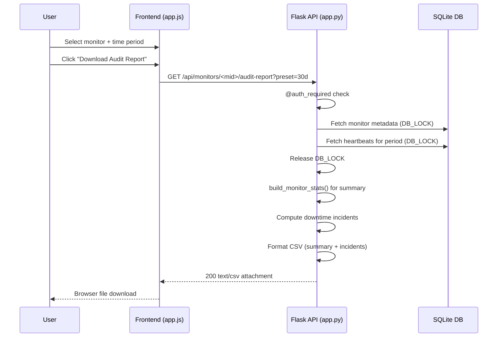

# Design Document: Monitor Audit Report

## Overview

The Monitor Audit Report feature adds a backend API endpoint and a frontend download panel that together allow users to generate and download CSV reports containing monitor uptime statistics and downtime incident details for a specified time period.

The design reuses existing infrastructure:
- `build_monitor_stats()` for uptime/latency calculations
- `parse_timeframe()` for time period parsing
- The `csv` + `io.StringIO` pattern from the software inventory export
- `@auth_required` decorator for authentication
- `DB_LOCK` for thread-safe database access

The CSV is structured in two logical sections (summary + incidents) separated by a blank row, making it both human-readable and machine-parseable.

## Architecture



The endpoint lives alongside existing monitor routes in `app.py`. No new database tables or migrations are required — the feature reads from existing `monitors` and `heartbeats` tables.

## Components and Interfaces

### Backend: Audit Report Endpoint

**Route:** `GET /api/monitors/<int:mid>/audit-report`

**Query Parameters:**
| Parameter | Type | Description |
|-----------|------|-------------|
| `preset` | string | One of `7d`, `30d`, `90d` (default: `30d`) |
| `from_dt` | ISO 8601 string | Custom range start (overrides preset) |
| `to_dt` | ISO 8601 string | Custom range end (overrides preset) |

**Response:** CSV file download with `Content-Type: text/csv; charset=utf-8`

**Filename pattern:** `{monitor_name}_audit_{from_date}_to_{to_date}.csv`
- `monitor_name` is sanitized (non-alphanumeric replaced with `_`)
- Dates formatted as `YYYY-MM-DD`

**Error responses:**
- `401` — Not authenticated
- `404` — Monitor not found
- `500` — Database error

### Backend: Helper Function

**`compute_downtime_incidents(heartbeats, period_end)`**

Processes an ordered list of heartbeat rows and groups consecutive down (status=0) heartbeats into incident objects.

**Input:** List of heartbeat dicts (ordered by `checked_at` ASC), period end datetime
**Output:** List of incident dicts

### Frontend: Audit Report Panel

A UI section added to the monitor detail view containing:
- Time period selector (preset buttons + custom date inputs)
- "Download Audit Report" button
- Loading spinner during generation
- Error toast on failure

The panel calls the API endpoint and triggers a browser file download using a dynamically created `<a>` element with `blob:` URL.

## Data Models

### Heartbeat Row (existing, read-only)

```python
{
    "id": int,
    "monitor_id": int,
    "status": int,          # 1=up, 0=down
    "latency_ms": float,
    "msg": str,
    "checked_at": str       # "YYYY-MM-DD HH:MM:SS"
}
```

### Monitor Row (existing, read-only)

```python
{
    "id": int,
    "name": str,
    "url": str,
    "type": str,
    "interval": int,        # seconds
    "retries": int,
    "timeout": int,
    "keyword": str,
    "accepted_codes": str,
    "enabled": int,
    "notify_email": str,
    "description": str,
    "tags": str,
    "group_name": str,
    "created_at": str
}
```

### Downtime Incident (computed)

```python
{
    "incident_number": int,
    "start_time": str,      # ISO 8601
    "end_time": str,        # ISO 8601
    "duration_seconds": int,
    "failed_checks": int,
    "status": str,          # "Resolved" or "Ongoing"
    "error_message": str    # msg from first failed check
}
```

### CSV Output Structure

```
Field,Value
Monitor Name,{name}
URL,{url}
Type,{type}
Check Interval (s),{interval}
Report Period Start,{from_dt ISO 8601}
Report Period End,{to_dt ISO 8601}
Uptime (%),{uptime_pct}
Total Checks,{total}
Up Count,{up}
Down Count,{down}
Average Latency (ms),{avg_latency}
<blank row>
Incident_Number,Start_Time,End_Time,Duration_Seconds,Failed_Checks,Status,Error_Message
1,2024-01-15T03:22:00,...
```


## Correctness Properties

*A property is a characteristic or behavior that should hold true across all valid executions of a system — essentially, a formal statement about what the system should do. Properties serve as the bridge between human-readable specifications and machine-verifiable correctness guarantees.*

### Property 1: Filename sanitization preserves structure

*For any* monitor name (including special characters, spaces, unicode) and any valid date range, the generated filename SHALL match the pattern `{sanitized_name}_audit_{YYYY-MM-DD}_to_{YYYY-MM-DD}.csv` where `sanitized_name` contains only alphanumeric characters, hyphens, and underscores.

**Validates: Requirements 1.6**

### Property 2: Summary section completeness and correctness

*For any* monitor metadata and any sequence of heartbeats within a time period, the CSV summary section SHALL contain all required fields (monitor name, URL, type, interval, period start, period end, uptime %, total checks, up count, down count, average latency) with values that are consistent with the input data — specifically: `up_count + down_count == total_checks`, `uptime_pct == round(up_count / total_checks * 100, 2)` when total > 0, and all stats are zero when no heartbeats exist.

**Validates: Requirements 2.1, 2.2, 2.3, 2.4**

### Property 3: Downtime incident grouping correctness

*For any* ordered sequence of heartbeats with mixed up/down statuses, the incident computation algorithm SHALL produce incidents such that: (a) every heartbeat with status=0 belongs to exactly one incident, (b) no heartbeat with status=1 belongs to any incident, (c) incidents are non-overlapping and chronologically ordered, (d) each incident's `failed_checks` equals the count of down heartbeats it contains, and (e) each incident's `duration_seconds` equals the difference between its end_time and start_time.

**Validates: Requirements 3.1, 3.2, 3.3**

### Property 4: CSV structural invariant

*For any* report data (monitor + heartbeats), the generated CSV SHALL follow the structure: a summary section of key-value rows (exactly 2 columns each), followed by exactly one blank separator row, followed by an incidents section with a header row of exactly 7 columns and data rows of exactly 7 columns each.

**Validates: Requirements 4.1, 4.2, 4.3**

### Property 5: Timestamp format invariant

*For any* timestamps appearing in the CSV output (in both summary and incidents sections), the value SHALL match the ISO 8601 pattern `YYYY-MM-DDTHH:MM:SS`.

**Validates: Requirements 4.4**

## Error Handling

| Scenario | HTTP Status | Response | Action |
|----------|-------------|----------|--------|
| Unauthenticated request | 401 | `{"error": "Not authenticated"}` | `@auth_required` rejects before handler |
| Monitor ID not found | 404 | `{"error": "Monitor not found"}` | Return immediately after DB lookup |
| Invalid date format in from_dt/to_dt | 400 | `{"error": "Invalid date format"}` | Catch `ValueError` from `fromisoformat()` |
| Database error during query | 500 | `{"error": "Report generation failed"}` | Catch `sqlite3.Error`, log traceback, return 500 |
| Empty heartbeat data | 200 | Valid CSV with zero stats | Not an error — produce report with zeros and empty incidents |

**Lock safety:** The `DB_LOCK` is acquired only for the data-fetch phase. CSV formatting happens outside the lock to avoid blocking other requests during string operations.

**Large dataset handling:** When heartbeat count exceeds 100,000 rows, the endpoint uses Flask's streaming response (`Response(generate(), mimetype=...)`) with a generator function that yields CSV rows incrementally, avoiding full in-memory buffering.

## Testing Strategy

### Unit Tests (example-based)

| Test | Validates |
|------|-----------|
| GET with valid preset returns 200 + CSV content-type | Req 1.1 |
| GET with each preset (7d, 30d, 90d) uses correct date range | Req 1.2 |
| GET for non-existent monitor returns 404 | Req 1.4 |
| Unauthenticated GET returns 401 | Req 1.5 |
| Report with no heartbeats has zero stats | Req 2.4 |
| Report with all-up heartbeats has empty incidents (headers only) | Req 3.4 |
| Ongoing incident at period end marked correctly | Req 3.3 |
| Database error returns 500 | Req 6.3 |

### Property-Based Tests

**Library:** [Hypothesis](https://hypothesis.readthedocs.io/) (Python)

**Configuration:** Minimum 100 iterations per property test.

| Property Test | Tag |
|---------------|-----|
| Filename sanitization | Feature: monitor-audit-report, Property 1: Filename sanitization preserves structure |
| Summary completeness | Feature: monitor-audit-report, Property 2: Summary section completeness and correctness |
| Incident grouping | Feature: monitor-audit-report, Property 3: Downtime incident grouping correctness |
| CSV structure | Feature: monitor-audit-report, Property 4: CSV structural invariant |
| Timestamp format | Feature: monitor-audit-report, Property 5: Timestamp format invariant |

**Generators needed:**
- `monitor_name_strategy`: Arbitrary unicode strings (including special chars, spaces, empty-ish names)
- `heartbeat_sequence_strategy`: Lists of `(status: 0|1, latency_ms: float, msg: str, checked_at: datetime)` tuples ordered by timestamp
- `date_range_strategy`: Pairs of datetimes where `from_dt < to_dt`
- `monitor_metadata_strategy`: Dicts with random but valid monitor field values

### Integration Tests

| Test | Validates |
|------|-----------|
| Full endpoint round-trip with seeded DB data | Req 1.1–1.6 |
| Large dataset (>100k rows) returns streaming response | Req 6.2 |
| DB_LOCK released before CSV formatting (timing assertion) | Req 6.1 |

### Frontend Tests (manual/example-based)

| Test | Validates |
|------|-----------|
| Audit report panel visible on monitor detail page | Req 5.1 |
| Preset buttons and date picker present | Req 5.2 |
| Download button triggers API call with correct params | Req 5.3 |
| Loading indicator shown during download | Req 5.4 |
| Error notification on API failure | Req 5.5 |
