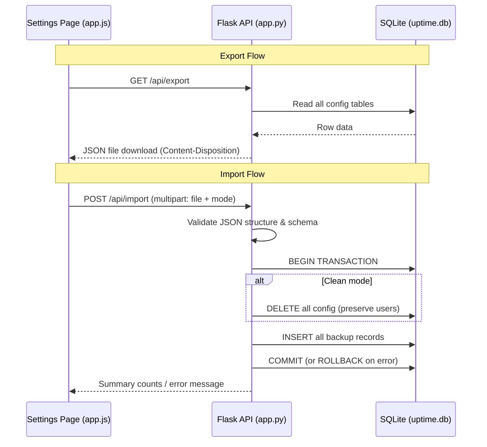
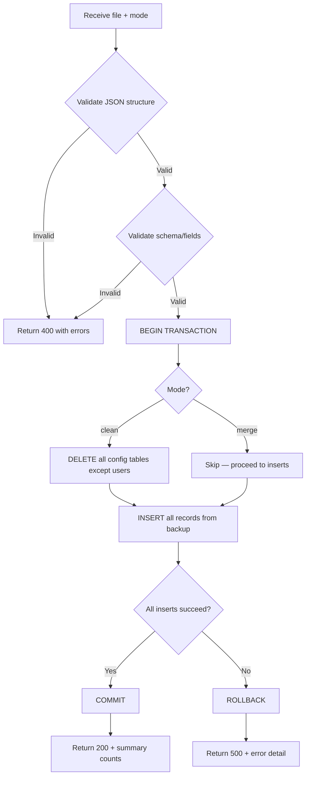

# Design Document: Monitor Export/Import

## Overview

This feature adds disaster recovery capabilities to the CROIT Monitor APP by providing full configuration export to JSON and import from JSON. Administrators can back up all monitor configurations, database monitors, status pages, settings, server/software inventory, service topology, and version trackers — then restore them when the `uptime.db` database is lost or corrupted.

The implementation follows the existing single-file Flask backend pattern with two new API endpoints (`GET /api/export`, `POST /api/import`) and a corresponding UI section in the Settings page.

### Design Decisions

1. **Single-transaction import**: All inserts wrapped in one SQLite transaction for atomicity — partial imports cannot corrupt the database.
2. **Two import modes**: "clean" (wipe-and-restore) for full disaster recovery, "merge" (skip duplicates) for additive migration between instances.
3. **Validation-first**: All structural/schema validation completes before any database writes begin.
4. **Passwords included in export**: DB monitor passwords are exported as-stored to enable full recovery without manual credential re-entry. User account password hashes are explicitly excluded.
5. **Format versioning**: Enables future schema evolution while maintaining backward compatibility.

## Architecture

The feature integrates into the existing Flask monolith (`app.py`) using established patterns:



## Components and Interfaces

### Backend API Endpoints

#### `GET /api/export`

| Aspect | Detail |
|--------|--------|
| Auth | `@role_required(['admin'])` |
| Response | `200` with JSON body, `Content-Disposition: attachment; filename="croit-monitor-backup-YYYY-MM-DD.json"` |
| Error | `500` if database read fails |

Implementation approach:
```python
@app.route("/api/export", methods=["GET"])
@role_required(['admin'])
def api_export():
    with DB_LOCK, get_db() as conn:
        # Read all tables, build export dict
        ...
    response = app.response_class(
        json.dumps(export_data, indent=2),
        mimetype="application/json",
        headers={"Content-Disposition": f'attachment; filename="croit-monitor-backup-{date}.json"'}
    )
    return response
```

#### `POST /api/import`

| Aspect | Detail |
|--------|--------|
| Auth | `@role_required(['admin'])` |
| Content-Type | `multipart/form-data` |
| Form fields | `file` (JSON file, max 50 MB), `mode` (string: `"clean"` or `"merge"`, default `"clean"`) |
| Success | `200` with summary JSON |
| Errors | `400` (validation), `500` (transaction failure) |

Implementation approach:
```python
@app.route("/api/import", methods=["POST"])
@role_required(['admin'])
def api_import():
    file = request.files.get('file')
    mode = request.form.get('mode', 'clean')
    # 1. Validate file size, JSON parsing, schema
    # 2. BEGIN transaction
    # 3. If clean: DELETE all config tables (not users)
    # 4. INSERT records from backup
    # 5. COMMIT or ROLLBACK
    # 6. Return summary counts
```

### Frontend UI Component

Added to the Settings page in `frontend/dist/app.js` within the existing `loadSettings()` function flow:

- **Export/Import section** rendered below existing settings sections
- **Export button**: triggers `fetch('/api/export')` and initiates blob download
- **File input**: accepts `.json` files only, shows selected filename
- **Mode selector**: radio buttons — "Clean Restore" (default) / "Merge"
- **Import button**: uploads via `FormData` to `POST /api/import`
- **Notifications**: success (auto-dismiss 5s) / error (persist until dismissed)
- **Loading state**: disables buttons during operation

## Data Models

### Export JSON Schema

```json
{
  "metadata": {
    "exported_at": "2026-06-15T10:30:00Z",
    "app_version": "1.0.0",
    "format_version": "1.0",
    "warning": "This file contains sensitive credentials (database passwords, SMTP passwords). Store securely."
  },
  "monitors": [
    {
      "name": "string",
      "url": "string",
      "type": "http|https|tcp|keyword|http-post",
      "interval": 60,
      "retries": 3,
      "timeout": 10,
      "keyword": "string|null",
      "accepted_codes": "200-299",
      "enabled": 1,
      "notify_email": 0,
      "description": "string|null",
      "tags": "string|null",
      "group_name": "",
      "request_body": "string|null",
      "request_headers": "string|null"
    }
  ],
  "db_monitors": [
    {
      "name": "string",
      "db_type": "mssql",
      "host": "string",
      "port": 1433,
      "database": "string|null",
      "username": "string|null",
      "password": "string|null",
      "interval": 60,
      "enabled": 1,
      "notify_email": 0,
      "description": "string|null",
      "group_name": "",
      "long_running_threshold": "integer|null"
    }
  ],
  "status_pages": [
    {
      "slug": "string",
      "title": "string",
      "description": "string|null",
      "theme": "dark",
      "show_tags": 0,
      "custom_css": "string|null",
      "monitors": [
        { "monitor_name": "string", "monitor_url": "string", "sort_order": 0 }
      ]
    }
  ],
  "settings": [
    { "key": "string", "value": "string|null" }
  ],
  "maintenance_windows": [
    {
      "monitor_name": "string|null",
      "monitor_url": "string|null",
      "title": "string",
      "start_dt": "string",
      "end_dt": "string",
      "repeat_weekly": 0
    }
  ],
  "servers": [
    {
      "hostname": "string",
      "ip_address": "string|null",
      "os": "string|null",
      "environment": "PROD",
      "role": "string|null",
      "cpu_cores": "integer|null",
      "ram_gb": "integer|null",
      "disk_gb": "integer|null",
      "location": "string|null",
      "last_patched": "string|null",
      "notes": "string|null"
    }
  ],
  "software_inventory": [
    {
      "server_hostname": "string",
      "name": "string",
      "version": "string|null",
      "vendor": "string|null",
      "license_type": "string|null",
      "support_status": "string|null",
      "risk_rating": "string|null",
      "install_path": "string|null",
      "discovered_by": "manual"
    }
  ],
  "software_catalogue": [
    {
      "name_pattern": "string",
      "vendor": "string|null",
      "license_type": "string|null",
      "support_status": "Supported",
      "risk_rating": "Low",
      "notes": "string|null"
    }
  ],
  "service_dependencies": [
    {
      "monitor_name": "string",
      "monitor_url": "string",
      "depends_on_name": "string",
      "depends_on_url": "string",
      "label": "string|null"
    }
  ],
  "topology_positions": [
    {
      "monitor_name": "string",
      "monitor_url": "string",
      "pos_x": 0.0,
      "pos_y": 0.0
    }
  ],
  "version_trackers": [
    {
      "name_match": "string",
      "display_name": "string",
      "check_type": "github_release|jenkins_update_center|url_regex",
      "check_source": "string",
      "regex_pattern": "string|null",
      "enabled": 1,
      "notes": "string|null"
    }
  ]
}
```

### Key Design Decisions on Schema

1. **Name-based references instead of IDs**: Status page monitor assignments, maintenance windows, service dependencies, and topology positions reference monitors by `name + url` rather than internal auto-increment IDs. This allows portability across databases where IDs differ.

2. **Actual table names mapped to export keys**: The database tables `dependencies` and `topology_layout` are exposed as `service_dependencies` and `topology_positions` in the JSON schema for clarity.

3. **Server references in software_inventory**: Use `server_hostname` as the join key (looked up during import) since server IDs are not portable.

### Duplicate Detection Keys (Merge Mode)

| Category | Unique Key |
|----------|-----------|
| monitors | `name` + `url` |
| db_monitors | `name` + `host` + `port` + `database` |
| status_pages | `slug` |
| servers | `hostname` |
| software_inventory | `server_hostname` + `name` |
| software_catalogue | `name_pattern` + `vendor` |
| service_dependencies | `monitor_name` + `monitor_url` + `depends_on_name` + `depends_on_url` |
| version_trackers | `name_match` + `check_source` |
| settings | `key` (upsert — always overwrite) |
| maintenance_windows | no duplicate check (always insert) |

### Import Transaction Flow



## Correctness Properties

*A property is a characteristic or behavior that should hold true across all valid executions of a system — essentially, a formal statement about what the system should do. Properties serve as the bridge between human-readable specifications and machine-verifiable correctness guarantees.*

### Property 1: Export/Import Round-Trip Preserves Configuration

*For any* valid database state containing monitors, db_monitors, status_pages, settings, maintenance_windows, servers, software_inventory, software_catalogue, service_dependencies, topology_positions, and version_trackers, exporting the configuration and then importing it in "clean" mode into an empty database SHALL produce a database state equivalent to the original (excluding auto-increment IDs, timestamps, and heartbeat/metrics data).

**Validates: Requirements 1.1, 1.2, 1.3, 1.4, 1.5, 1.6, 1.7, 1.8, 1.9, 1.10, 1.14, 2.1, 2.2, 2.3, 2.4, 2.5, 2.6, 2.7, 2.8, 2.9, 2.10, 6.5**

### Property 2: Structural Validation Rejects Invalid Backups and Identifies Violations

*For any* JSON object that is missing required top-level sections, missing metadata/format_version, has an unsupported format_version, or contains monitor/db_monitor entries missing required fields, the Import_Service SHALL reject it with a 400 status and an error message that correctly identifies all specific violations (missing sections by name, invalid entries by array index).

**Validates: Requirements 3.2, 3.3, 3.4, 3.5, 3.6, 3.8**

### Property 3: Clean Mode Replaces All Configuration But Preserves Users

*For any* existing database state and *any* valid backup file, importing in "clean" mode SHALL result in the configuration tables containing only the backup data, while the users table remains completely unchanged (same rows, same passwords, same roles).

**Validates: Requirements 4.1, 4.3**

### Property 4: Merge Mode Skips Duplicates and Reports Accurately

*For any* existing database state and *any* valid backup file imported in "merge" mode, records with matching unique keys SHALL not be modified, non-duplicate records SHALL be inserted, and the response summary SHALL report counts where `inserted + skipped = total_in_backup` for each category.

**Validates: Requirements 4.2, 4.6**

### Property 5: Export Includes DB Passwords But Excludes User Password Hashes

*For any* database state, the exported JSON SHALL contain the `password` field from every db_monitor record verbatim, and SHALL NOT contain any field value that matches any user's password hash from the users table.

**Validates: Requirements 6.1, 6.3**

### Property 6: Transaction Atomicity on Import Failure

*For any* valid backup file and *any* point of failure during the INSERT phase, if the transaction fails, the database SHALL be in exactly the same state as before the import attempt began (zero records added, zero records deleted).

**Validates: Requirements 2.11, 2.13**

### Property 7: Import Summary Counts Match Actual Records

*For any* successful import, the count reported for each category in the response summary SHALL equal the actual number of records inserted into that category's database table during the import operation.

**Validates: Requirements 2.12**

## Error Handling

### Backend Error Strategy

| Scenario | HTTP Status | Response Body |
|----------|-------------|---------------|
| Not authenticated | 401 | `{"error": "Not authenticated"}` |
| Not admin role | 403 | `{"error": "Access denied"}` |
| No file uploaded | 400 | `{"error": "No file provided"}` |
| File exceeds 50 MB | 400 | `{"error": "File too large. Maximum size is 50 MB."}` |
| Invalid JSON | 400 | `{"error": "Invalid JSON: <parse_error_detail>"}` |
| Missing metadata | 400 | `{"error": "Missing required section: metadata"}` |
| Missing format_version | 400 | `{"error": "Missing required field: metadata.format_version"}` |
| Unsupported version | 400 | `{"error": "Unsupported format version '2.0'. Supported: ['1.0']"}` |
| Missing sections | 400 | `{"error": "Missing required sections: monitors, servers"}` |
| Invalid monitor entry | 400 | `{"error": "Invalid monitor at index 3: missing required field 'url'"}` |
| Invalid db_monitor entry | 400 | `{"error": "Invalid db_monitor at index 1: missing required field 'host'"}` |
| Invalid mode value | 400 | `{"error": "Invalid mode 'append'. Valid options: clean, merge"}` |
| DB read error (export) | 500 | `{"error": "Export failed: database read error"}` |
| Transaction failure (import) | 500 | `{"error": "Import failed: <detail>. All changes have been rolled back."}` |

### Frontend Error Handling

- **Network errors**: Display "Could not connect to server. Please check your connection."
- **Timeout (30s)**: Display "Request timed out. Please try again."
- **4xx/5xx responses**: Extract `error` field from JSON response and display in persistent notification
- **Success**: Display summary counts in auto-dismissing notification (5 seconds)
- **Loading state**: Both Export and Import buttons disabled during any operation to prevent concurrent requests

### Database Safety

- The `DB_LOCK` threading lock prevents concurrent export/import operations from conflicting with monitoring loops
- SQLite WAL mode allows reads during the import transaction without blocking the monitoring threads
- The import transaction uses explicit `conn.execute("BEGIN")` and `conn.commit()` / `conn.rollback()` to ensure atomicity outside the context manager's auto-commit

## Testing Strategy

### Property-Based Tests (pytest + Hypothesis)

Property-based testing applies well here because the export/import logic is pure data transformation with clear round-trip properties. The input space (combinations of monitor configurations, settings, etc.) is large and varied.

**Library**: Hypothesis (Python)
**Minimum iterations**: 100 per property
**Tag format**: `Feature: monitor-export-import, Property {N}: {title}`

Each correctness property (1–7) maps to one property-based test that generates random valid configurations and verifies the property holds.

Key strategies:
- **Custom Hypothesis strategies** for generating valid monitor configs, db_monitor configs, server records, etc.
- **In-memory SQLite** for fast test execution (no disk I/O)
- **Round-trip testing**: Export → clear DB → Import → compare

### Unit Tests (pytest)

- Export endpoint returns correct Content-Disposition header format
- Export metadata contains required fields (timestamp, version, warning)
- Access control: 401 for unauthenticated, 403 for non-admin
- File size rejection at 50 MB boundary
- Invalid mode values rejected
- Empty database exports valid JSON with empty arrays

### Integration Tests

- Full export → import cycle via HTTP test client
- Merge mode with known duplicate data
- Clean mode preserves user accounts
- Large file handling (near 50 MB limit)
- Concurrent export during active monitoring (no deadlock)
