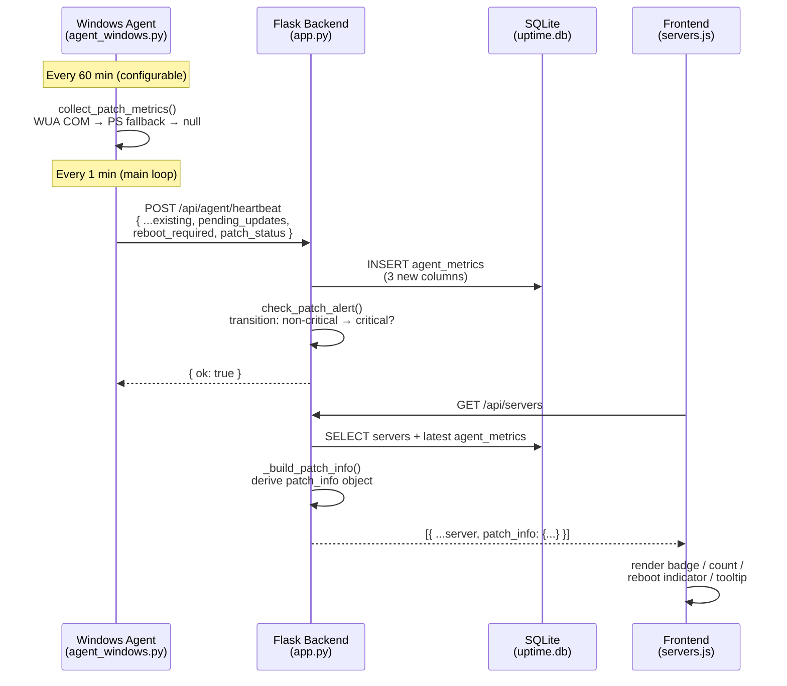

# Design Document — patch-security-depth

## Overview

This feature enriches the Server Inventory section of the Podman Dashboard with three additional patch and security data points per Windows server: **pending update count**, **reboot-required flag**, and a **patch status badge** (`up_to_date` / `updates_pending` / `critical`). The data flows from the Windows Agent through the existing heartbeat pipeline to the Flask backend and is rendered on each Server Card in the frontend.

The design touches four layers:

1. **Windows Agent** (`agent_windows.py`) — new patch metric collection with a configurable, independent collection interval and a PowerShell fallback chain.
2. **Flask Backend** (`app.py`) — schema migration, heartbeat ingestion, server API enrichment, and critical-patch email alerting.
3. **Frontend** (`frontend/dist/index.html` / `servers.js`) — badge rendering, count display, reboot indicator, and tooltip.
4. **Database** (`uptime.db`) — three new columns on `agent_metrics`.

No new tables are required. All changes are additive and backward-compatible with agents that do not yet send patch fields.

---

## Architecture



### Key Design Decisions

**Separate patch collection interval**: The Windows Update API is slow (COM round-trip, WSUS query) and should not block the main 1-minute heartbeat. The agent caches the last collected patch values and re-uses them on every heartbeat until the patch interval elapses. This keeps heartbeat latency low while still delivering fresh patch data.

**Null-safe throughout**: Any layer that fails to produce patch data sets all three fields to `null`. The backend stores `NULL`, the API returns `null`, and the frontend renders a "Patch status unknown" grey badge. No layer crashes on missing patch data.

**Patch status derivation in the backend**: The agent sends the raw `patch_status` string it computed. The backend applies a fallback rule: if `patch_status` is `null` but `last_patched` is set on the server record, the API response promotes the status to `up_to_date`. This keeps the frontend logic simple.

**Alert deduplication in memory**: The 24-hour suppression timer is stored in a module-level dict (same pattern as `_last_alert_sent` used for CPU/RAM/disk alerts). This is sufficient for a single-process deployment. The timer is keyed by `server_id` and reset when the server transitions away from `critical`.

---

## Components and Interfaces

### 1. Agent — `collect_patch_metrics()`

New function added to `agent_windows.py`. Returns a dict:

```python
{
    "pending_updates":  int | None,   # count of available-but-not-installed updates
    "reboot_required":  bool | None,  # True if reboot is pending
    "patch_status":     str | None,   # "up_to_date" | "updates_pending" | "critical"
}
```

**Collection strategy (priority order):**

1. **WUA COM API** (`win32com.client` / `pythoncom`) — primary method.
2. **PSWindowsUpdate PowerShell module** — first fallback when COM raises `com_error` or `ImportError`.
3. **Native COM via PowerShell** (`Microsoft.Update.Session` COM object invoked through `powershell.exe`) — second fallback when PSWindowsUpdate is not installed.
4. **Null result** — all three fields set to `null` when all methods fail; exception logged.

**Reboot detection** (independent of update count, always attempted via `winreg`):

- `HKLM\SOFTWARE\Microsoft\Windows\CurrentVersion\WindowsUpdate\Auto Update\RebootRequired` key exists → `True`
- `HKLM\SYSTEM\CurrentControlSet\Control\Session Manager\PendingFileRenameOperations` value is non-empty → `True`
- Neither condition → `False`
- `winreg` unavailable → `None`

**Severity classification** (pure function, no I/O):

```
classify_patch_status(updates: list[dict]) -> str
  if len(updates) == 0:                          return "up_to_date"
  if any u["severity"] in {"Critical","Important"}: return "critical"
  return "updates_pending"
```

### 2. Agent — Interval Scheduling

New state added to `main()`:

```python
last_patch_time   = 0          # epoch seconds; 0 forces immediate collection on first run
cached_patch      = {"pending_updates": None, "reboot_required": None, "patch_status": None}
patch_interval_s  = args.patch_interval * 60   # default 3600
```

On each heartbeat cycle:

```python
if time.time() - last_patch_time >= patch_interval_s:
    cached_patch    = collect_patch_metrics()
    last_patch_time = time.time()
metrics.update(cached_patch)
```

New CLI argument: `--patch-interval N` (minutes, default `60`).

### 3. Backend — Schema Migration

Added to `init_db()` alongside existing `ALTER TABLE` migrations:

```python
for col, defn in [
    ("pending_updates", "INTEGER"),
    ("reboot_required", "INTEGER"),   # SQLite stores bool as 0/1
    ("patch_status",    "TEXT"),
]:
    try:
        conn.execute(f"ALTER TABLE agent_metrics ADD COLUMN {col} {defn}")
        print(f"[DB] Migrated: added {col} to agent_metrics.")
    except Exception:
        pass  # column already exists
```

### 4. Backend — Heartbeat Endpoint

`api_agent_heartbeat()` extended to read and store the three new fields:

```python
conn.execute("""
    INSERT INTO agent_metrics
    (...existing columns..., pending_updates, reboot_required, patch_status)
    VALUES (..., ?, ?, ?)
""", (..., d.get("pending_updates"), d.get("reboot_required"), d.get("patch_status")))
```

After storing, calls `_check_patch_alert(server_id, d)`.

### 5. Backend — `_check_patch_alert(server_id, payload)`

```python
_patch_alert_sent = {}   # server_id -> epoch seconds of last critical alert

def _check_patch_alert(server_id, payload):
    new_status = payload.get("patch_status")
    if new_status != "critical":
        if server_id in _patch_alert_sent:
            del _patch_alert_sent[server_id]   # reset suppression on non-critical
        return

    # Fetch previous stored patch_status
    with DB_LOCK, get_db() as conn:
        prev = conn.execute(
            "SELECT patch_status FROM agent_metrics WHERE server_id=? "
            "ORDER BY collected_at DESC LIMIT 1 OFFSET 1",
            (server_id,)
        ).fetchone()
    prev_status = prev["patch_status"] if prev else None

    if prev_status == "critical":
        # Already critical — check suppression window
        last_sent = _patch_alert_sent.get(server_id, 0)
        if time.time() - last_sent < 86400:
            return   # suppress duplicate

    # Send alert
    _send_patch_alert(server_id, payload)
    _patch_alert_sent[server_id] = time.time()
```

### 6. Backend — `_build_patch_info(server_id, conn)`

New helper called from `_server_with_health()`:

```python
def _build_patch_info(server_id, last_patched, conn):
    row = conn.execute(
        "SELECT pending_updates, reboot_required, patch_status, collected_at "
        "FROM agent_metrics WHERE server_id=? ORDER BY collected_at DESC LIMIT 1",
        (server_id,)
    ).fetchone()

    if row:
        status = row["patch_status"]
        if status is None and last_patched:
            status = "up_to_date"
        return {
            "pending_updates": row["pending_updates"],
            "reboot_required": bool(row["reboot_required"]) if row["reboot_required"] is not None else None,
            "patch_status":    status,
            "last_patched":    last_patched,
            "collected_at":    row["collected_at"],
        }
    return {
        "pending_updates": None,
        "reboot_required": None,
        "patch_status":    "up_to_date" if last_patched else None,
        "last_patched":    last_patched,
        "collected_at":    None,
    }
```

`_server_with_health()` is updated to call this and attach `result["patch_info"] = _build_patch_info(...)`.

### 7. Backend — `/api/agent/metrics/<server_id>`

The `latest` dict already returns all columns from `agent_metrics`. Once the three columns exist, they are automatically included. No additional code change needed beyond the schema migration.

### 8. Frontend — Server Card Patch Section

The existing `last_patched` field is retained. A new patch status block is inserted below it:

```
┌─────────────────────────────────────────┐
│  Last patched: 2025-11-15               │
│  [🔴 Critical updates] (3 updates)      │  ← badge + count
│  [🔁 Reboot required]                   │  ← conditional
└─────────────────────────────────────────┘
```

Badge rendering logic (JavaScript):

```javascript
function renderPatchBadge(patchInfo) {
    const { patch_status, pending_updates, reboot_required, collected_at } = patchInfo || {};
    const tooltip = collected_at ? `Patch data collected: ${collected_at}` : '';

    let badge = '';
    if (patch_status === 'up_to_date') {
        badge = `<span class="badge badge-green" title="${tooltip}">✅ Up-to-date</span>`;
    } else if (patch_status === 'updates_pending') {
        badge = `<span class="badge badge-amber" title="${tooltip}">⚠ Updates pending</span>
                 <span class="badge-count">(${pending_updates} updates)</span>`;
    } else if (patch_status === 'critical') {
        badge = `<span class="badge badge-red" title="${tooltip}">🔴 Critical updates</span>
                 <span class="badge-count">(${pending_updates} updates)</span>`;
    } else {
        badge = `<span class="badge badge-grey" title="${tooltip}">— Patch status unknown</span>`;
    }

    const rebootHtml = reboot_required
        ? `<span class="badge badge-amber badge-reboot">🔁 Reboot required</span>`
        : '';

    return `<div class="patch-status">${badge}${rebootHtml}</div>`;
}
```

---

## Data Models

### `agent_metrics` table (additions)

| Column | Type | Nullable | Description |
|---|---|---|---|
| `pending_updates` | INTEGER | YES | Count of available-but-not-installed Windows updates |
| `reboot_required` | INTEGER | YES | 1 = reboot pending, 0 = no reboot needed, NULL = unknown |
| `patch_status` | TEXT | YES | `up_to_date` \| `updates_pending` \| `critical` \| NULL |

All three columns are added via `ALTER TABLE … ADD COLUMN IF NOT EXISTS` migration. Existing rows receive `NULL` for all three columns.

### Heartbeat Payload (additions)

```json
{
  "os_name": "Windows Server 2022",
  "cpu_pct": 12.5,
  "...": "...existing fields...",
  "pending_updates": 3,
  "reboot_required": true,
  "patch_status": "critical"
}
```

All three fields are optional. If absent, the backend stores `NULL`.

### `patch_info` object (API response addition)

Included in every `/api/servers` and `/api/servers/<id>` response:

```json
{
  "patch_info": {
    "pending_updates": 3,
    "reboot_required": true,
    "patch_status": "critical",
    "last_patched": "2025-11-15",
    "collected_at": "2026-04-24 10:00:00"
  }
}
```

### Alert Suppression State (in-memory)

```python
_patch_alert_sent: dict[int, float]  # server_id → epoch seconds of last alert
```

---

## Correctness Properties

*A property is a characteristic or behavior that should hold true across all valid executions of a system — essentially, a formal statement about what the system should do. Properties serve as the bridge between human-readable specifications and machine-verifiable correctness guarantees.*

### Property 1: Patch status classification is exhaustive and correct

*For any* list of Windows update objects with varying `MsrcSeverity` values, `classify_patch_status()` SHALL return `"up_to_date"` if the list is empty, `"critical"` if any update has severity `"Critical"` or `"Important"`, and `"updates_pending"` otherwise. No other return value is possible.

**Validates: Requirements 1.3**

---

### Property 2: WUA failure produces all-null patch fields

*For any* exception raised by the WUA COM API (including `com_error`, `ImportError`, `OSError`, or any arbitrary exception), the patch collection function SHALL return a dict where `pending_updates`, `reboot_required`, and `patch_status` are all `None`.

**Validates: Requirements 1.4, 2.3**

---

### Property 3: Heartbeat payload always contains patch keys

*For any* result of `collect_metrics()` (whether patch collection succeeded, failed, or returned cached values), the returned dict SHALL always contain the keys `pending_updates`, `reboot_required`, and `patch_status`.

**Validates: Requirements 1.5**

---

### Property 4: Patch values are cached between collection intervals

*For any* cached patch result and any elapsed time strictly less than the configured patch interval, the heartbeat payload SHALL contain the cached `pending_updates`, `reboot_required`, and `patch_status` values unchanged, without re-querying the Windows Update API.

**Validates: Requirements 6.3**

---

### Property 5: Heartbeat storage round-trip preserves patch fields

*For any* heartbeat payload containing `pending_updates` (integer or null), `reboot_required` (boolean or null), and `patch_status` (string or null), after the payload is POSTed to `/api/agent/heartbeat` and the latest row is retrieved from `agent_metrics`, the stored values SHALL equal the submitted values. Payloads that omit any of the three fields SHALL result in `NULL` stored for those fields, and the endpoint SHALL return HTTP 200.

**Validates: Requirements 3.2, 3.4**

---

### Property 6: Server API response always includes patch_info

*For any* server record regardless of whether it has associated `agent_metrics` rows, the `/api/servers` and `/api/servers/<id>` responses SHALL include a `patch_info` object containing the keys `pending_updates`, `reboot_required`, `patch_status`, `last_patched`, and `collected_at`.

**Validates: Requirements 4.1**

---

### Property 7: Null patch_status with last_patched resolves to up_to_date

*For any* server where the most recent `agent_metrics` row has `patch_status = NULL` (or no metrics row exists) and the server record has a non-null `last_patched` date, the API response SHALL set `patch_info.patch_status` to `"up_to_date"`.

**Validates: Requirements 4.2**

---

### Property 8: Heartbeat never modifies last_patched

*For any* heartbeat payload (with or without patch fields, with any field values), after the payload is processed by `/api/agent/heartbeat`, the `last_patched` value on the corresponding `servers` row SHALL be identical to its value before the request.

**Validates: Requirements 4.4**

---

### Property 9: Badge count display for non-up-to-date statuses

*For any* `pending_updates` count N ≥ 0 and `patch_status` of either `"updates_pending"` or `"critical"`, the rendered Server Card HTML SHALL contain the string `"(N updates)"` where N is the actual count value.

**Validates: Requirements 5.2, 5.3**

---

### Property 10: Critical transition alert fires for all non-critical prior states

*For any* server whose most recently stored `patch_status` is one of `null`, `"up_to_date"`, or `"updates_pending"`, when a heartbeat arrives with `patch_status = "critical"`, the dashboard SHALL attempt to send an alert email (or log if SMTP is unconfigured). The alert SHALL fire regardless of which specific non-critical prior state the server was in.

**Validates: Requirements 7.1**

---

### Property 11: Alert suppression holds within 24-hour window

*For any* server that has already triggered a critical patch alert, subsequent heartbeats with `patch_status = "critical"` arriving within 24 hours of the first alert SHALL NOT trigger additional alert emails. The suppression SHALL hold for any number of repeated critical heartbeats within the window.

**Validates: Requirements 7.2**

---

### Property 12: Suppression timer resets on non-critical transition

*For any* server with an active 24-hour suppression timer, when a heartbeat arrives with `patch_status` of `"up_to_date"` or `"updates_pending"`, the suppression timer SHALL be cleared such that the next `critical` heartbeat for that server triggers a new alert.

**Validates: Requirements 7.4**

---

## Error Handling

| Failure scenario | Agent behaviour | Backend behaviour |
|---|---|---|
| WUA COM API unavailable (`com_error`, `ImportError`) | Attempt PSWindowsUpdate PowerShell fallback | — |
| PSWindowsUpdate not installed | Attempt native COM via PowerShell | — |
| All patch collection methods fail | Set all three fields to `null`; log warning | Store `NULL`; no error returned to agent |
| `winreg` unavailable for reboot check | Set `reboot_required` to `null` | Store `NULL` |
| Heartbeat payload missing patch fields | — | Store `NULL` for missing fields; return HTTP 200 |
| SMTP not configured when critical alert fires | — | Log alert condition to application log; no exception |
| `agent_metrics` columns already exist (re-run migration) | — | `ALTER TABLE` exception caught and silently ignored |
| Agent sends `patch_status` value not in known set | — | Stored as-is; frontend renders grey "unknown" badge |

---

## Testing Strategy

### Unit Tests

Focus on specific examples, edge cases, and pure-function correctness:

- `classify_patch_status([])` → `"up_to_date"`
- `classify_patch_status([{"severity": "Critical"}])` → `"critical"`
- `classify_patch_status([{"severity": "Low"}])` → `"updates_pending"`
- `_build_patch_info()` with no metrics row and `last_patched=None` → `patch_status=None`
- `_build_patch_info()` with no metrics row and `last_patched="2025-01-01"` → `patch_status="up_to_date"`
- `renderPatchBadge({patch_status: null})` → contains `"Patch status unknown"`
- `renderPatchBadge({patch_status: "up_to_date"})` → contains `"Up-to-date"` and `badge-green`
- `renderPatchBadge({reboot_required: true})` → contains `"Reboot required"`

### Property-Based Tests

Use **Hypothesis** (Python) for backend properties and **fast-check** (JavaScript) for frontend rendering properties. Each property test runs a minimum of **100 iterations**.

Tag format: `# Feature: patch-security-depth, Property N: <property_text>`

| Property | Test description | Library |
|---|---|---|
| P1 — Classification exhaustive | Generate random lists of update dicts with random severity strings; verify classification invariants | Hypothesis |
| P2 — WUA failure → all null | Generate arbitrary exception instances; verify all three fields are None | Hypothesis |
| P3 — Payload always has patch keys | Generate random metric collection outcomes; verify key presence | Hypothesis |
| P4 — Cache reuse within interval | Generate cached patch dicts and elapsed times < interval; verify payload unchanged | Hypothesis |
| P5 — Heartbeat round-trip | Generate random patch field combinations (including null); POST and verify stored values | Hypothesis + Flask test client |
| P6 — patch_info always present | Generate servers with varying metrics states; verify patch_info structure | Hypothesis + Flask test client |
| P7 — Null status + last_patched → up_to_date | Generate non-null last_patched dates with null stored patch_status; verify response | Hypothesis + Flask test client |
| P8 — Heartbeat never modifies last_patched | Generate arbitrary heartbeat payloads; verify last_patched unchanged | Hypothesis + Flask test client |
| P9 — Badge count display | Generate random N ≥ 0 with updates_pending/critical status; verify "(N updates)" in HTML | fast-check |
| P10 — Critical transition alert | Generate non-critical prior states; verify alert triggered | Hypothesis + mock SMTP |
| P11 — Alert suppression | Generate repeated critical heartbeats within 24h; verify single alert | Hypothesis + mock SMTP |
| P12 — Suppression reset | Generate non-critical transition then critical; verify alert fires | Hypothesis + mock SMTP |

### Integration Tests

- End-to-end: deploy agent against a test Flask instance, verify patch fields appear in `/api/servers` response.
- Schema migration: run `init_db()` twice on an existing database; verify no error and columns exist exactly once.
- SMTP fallback: configure no SMTP, trigger critical transition, verify log entry contains server hostname and update count.
