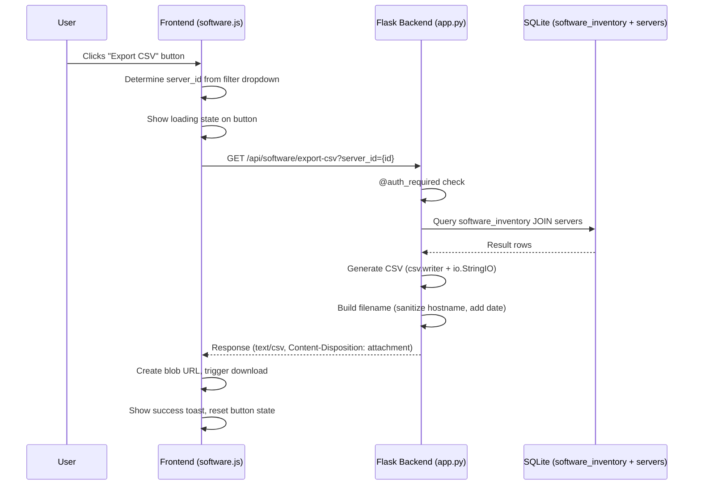

# Design Document: Software Inventory CSV Export

## Overview

This feature adds a CSV export capability to the CROIT Monitor APP's Software Inventory module. It consists of a new Flask API endpoint (`GET /api/software/export-csv`) that generates RFC 4180-compliant CSV files from the `software_inventory` table (joined with `servers` for hostname/environment), and a frontend Export button integrated into the existing Software Inventory tab actions area.

The design leverages Python's stdlib `csv` module for correct escaping and formatting, Flask's `Response` object for streaming the CSV with proper headers, and the existing `@auth_required` decorator for access control. The frontend uses the browser's native download mechanism via a dynamically created `<a>` element with a blob URL.

## Architecture



The architecture follows the existing pattern in the codebase:
- Backend: Single route function in `app.py` using `DB_LOCK` + `get_db()` context manager
- Frontend: Async function in `software.js` using `fetch()` with `credentials: 'include'`

## Components and Interfaces

### Backend Component: CSV Export Endpoint

**Route:** `GET /api/software/export-csv`

**Query Parameters:**
| Parameter | Type | Required | Description |
|-----------|------|----------|-------------|
| `server_id` | integer | No | Filter to a specific server. If omitted, exports all servers. |

**Response Headers:**
| Header | Value |
|--------|-------|
| `Content-Type` | `text/csv; charset=utf-8` |
| `Content-Disposition` | `attachment; filename="software-inventory_{hostname}_{YYYY-MM-DD}.csv"` |

**Response Body:** UTF-8 encoded CSV content with header row followed by data rows.

**Error Responses:**
| Status | Condition |
|--------|-----------|
| 401 | Not authenticated |
| 404 | `server_id` provided but server does not exist |

### Backend Helper: Filename Generator

```python
def _csv_export_filename(hostname: str | None) -> str:
    """Generate the CSV export filename.
    
    Args:
        hostname: Server hostname (None for all-servers export)
    
    Returns:
        Filename string like 'software-inventory_web-srv-01_2025-01-15.csv'
    """
```

**Sanitization rule:** Replace any character that is NOT alphanumeric, hyphen, or underscore with an underscore.

### Frontend Component: Export Button & Download Logic

**UI Element:** A button placed in `#sw-tab-actions-inventory` alongside existing action buttons.

**Function:** `exportSwCsv()`
- Reads `swServerFilter` to determine if a server is selected
- Constructs the API URL with optional `server_id` query param
- Fetches the CSV as a blob
- Creates a temporary `<a>` element with `download` attribute and blob URL
- Triggers click, then revokes the blob URL
- Manages button loading state and toast notifications

## Data Models

### CSV Column Mapping

The CSV output maps database columns to human-readable headers:

| CSV Header | Source | Table.Column |
|------------|--------|--------------|
| Server Hostname | servers | `s.hostname` |
| Environment | servers | `s.environment` |
| Software Name | software_inventory | `sw.name` |
| Version | software_inventory | `sw.version` |
| Vendor | software_inventory | `sw.vendor` |
| License Type | software_inventory | `sw.license_type` |
| Support Status | software_inventory | `sw.support_status` |
| Risk Rating | software_inventory | `sw.risk_rating` |
| Install Path | software_inventory | `sw.install_path` |
| Discovered By | software_inventory | `sw.discovered_by` |
| Created At | software_inventory | `sw.created_at` |

### SQL Query

The query reuses the existing pattern from `api_get_software()`:

```sql
SELECT sw.name, sw.version, sw.vendor, sw.license_type, 
       sw.support_status, sw.risk_rating, sw.install_path, 
       sw.discovered_by, sw.created_at,
       s.hostname, s.environment
FROM software_inventory sw
JOIN servers s ON s.id = sw.server_id
WHERE sw.server_id = ?          -- only when server_id provided
ORDER BY s.environment, s.hostname, sw.name
```

## Correctness Properties

*A property is a characteristic or behavior that should hold true across all valid executions of a system — essentially, a formal statement about what the system should do. Properties serve as the bridge between human-readable specifications and machine-verifiable correctness guarantees.*

### Property 1: Server filtering completeness

*For any* set of software inventory records and any optional server_id filter, the CSV output SHALL contain exactly the records matching that filter — all matching records present, no non-matching records included. When server_id is provided, every row in the CSV belongs to that server; when omitted, every record in the database appears in the CSV.

**Validates: Requirements 1.1, 1.2**

### Property 2: CSV field value round-trip

*For any* software inventory record whose fields contain arbitrary Unicode text (including commas, double quotes, newline characters, and multi-byte Unicode), serializing the record to CSV and then parsing the CSV back SHALL produce field values identical to the originals.

**Validates: Requirements 2.2, 2.3**

### Property 3: Null fields produce empty CSV fields

*For any* software inventory record where one or more fields are null or empty, the corresponding CSV fields SHALL be empty strings when parsed back, and the total number of fields per row SHALL remain constant (equal to the number of header columns).

**Validates: Requirements 2.4**

### Property 4: Filename generation with hostname sanitization

*For any* hostname string, the generated export filename SHALL match the pattern `software-inventory_{sanitized}_{YYYY-MM-DD}.csv` where `sanitized` contains only alphanumeric characters, hyphens, and underscores, and every alphanumeric character, hyphen, or underscore from the original hostname is preserved in its original position.

**Validates: Requirements 1.5, 4.1, 4.3**

## Error Handling

| Scenario | Backend Behavior | Frontend Behavior |
|----------|-----------------|-------------------|
| Unauthenticated request | Return 401 JSON error (via `@auth_required`) | Redirect to login (existing app behavior) |
| Invalid `server_id` (non-existent) | Return 404 with `{"error": "Server not found"}` | Show error toast with message |
| Empty result set (no software for server) | Return CSV with header row only (no data rows) | Download completes normally (file has headers only) |
| Database error | Return 500 with `{"error": "Internal server error"}` | Show error toast |
| Network failure | N/A | Show error toast "Export failed — check your connection" |

## Testing Strategy

### Unit Tests (Example-Based)

- **Header row correctness**: Verify the CSV header contains exactly the 11 specified columns in order (Req 1.3, 2.1)
- **Content-Type header**: Verify response has `text/csv; charset=utf-8` (Req 1.4)
- **Authentication enforcement**: Verify 401 when not logged in (Req 1.6)
- **All-servers filename**: Verify format `software-inventory_all-servers_{date}.csv` when no server_id (Req 4.2)
- **Loading state**: Verify button disables during export and re-enables after (Req 3.4)
- **Success toast**: Verify toast appears on successful download (Req 3.5)
- **Error toast**: Verify toast appears on failed download (Req 3.6)
- **404 for missing server**: Verify 404 when server_id doesn't exist

### Property-Based Tests

Property-based tests use Python's `hypothesis` library with minimum 100 iterations per property.

| Property | Test Description | Tag |
|----------|-----------------|-----|
| 1 | Generate random software records assigned to random servers, export with/without server_id filter, verify output completeness | Feature: software-inventory-csv-export, Property 1: Server filtering completeness |
| 2 | Generate random Unicode strings with special CSV characters, place in record fields, export to CSV, parse back, assert equality | Feature: software-inventory-csv-export, Property 2: CSV field value round-trip |
| 3 | Generate records with random nullable fields set to None, export, parse back, verify empty strings and consistent column count | Feature: software-inventory-csv-export, Property 3: Null fields produce empty CSV fields |
| 4 | Generate random hostname strings with special characters, call filename generator, verify regex match and character preservation | Feature: software-inventory-csv-export, Property 4: Filename generation with hostname sanitization |

### Integration Tests

- End-to-end test: Seed database, make authenticated GET to `/api/software/export-csv`, verify full response (headers + body)
- Frontend integration: Verify export button exists in DOM and triggers correct API call with current filter state
